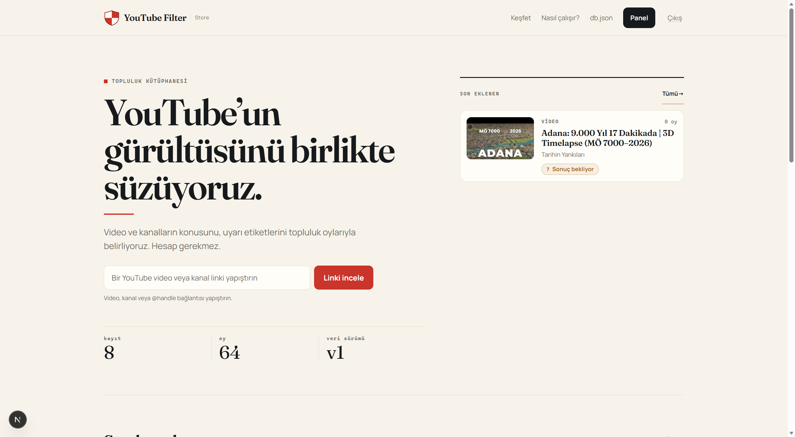
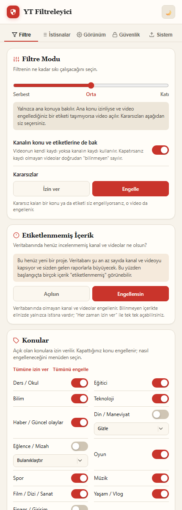
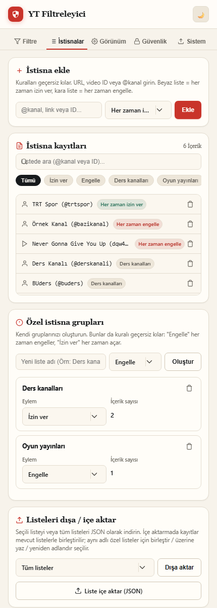
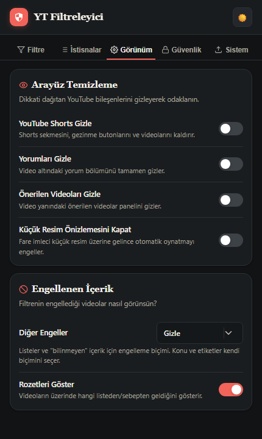
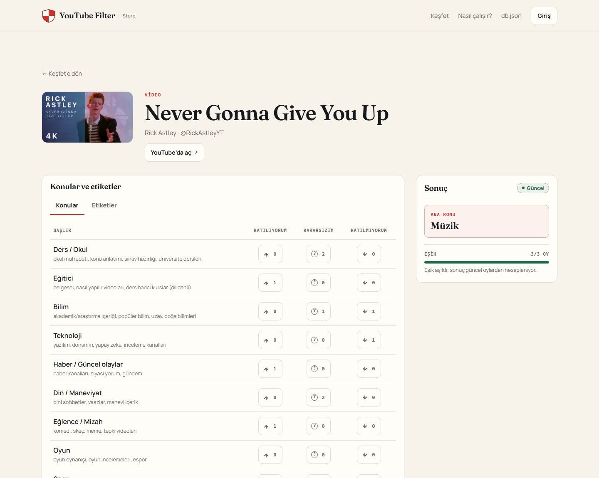

# YouTube Filtreleyici

**Konu ve etiket tabanlı, topluluk verisiyle çalışan YouTube filtresi.** Bu depo iki parçayı birlikte geliştirir:

- **YT Filtreleyici uzantısı** — Chromium ve Firefox üzerinde YouTube'u yerelde filtreler.
- **YouTube Filter Store** — anonim oylarla konu/etiket verisi üretir, editör ve admin moderasyonunu yürütür, sürümlü `db.json` yayımlar.

<p align="center">
  
</p>
<p align="center"><sub>YouTube Filter Store — yerel demo verisiyle alınmış ekran görüntüsü</sub></p>

> **Durum:** 2.1.0 geliştirme dalı. Uzantı ve site yerelde doğrulandı; site S1–S7 dilimleri tamamlandı. Gerçek tarayıcı/ekran okuyucu QA'sı, GitHub Releases paketlemesi ve Docker/PostgreSQL/Caddy üretim denemesi henüz yapılmadı.

> **Veri notu:** Paketli `src/data/db.json` şu an yalnızca örnek bir kanal içeriyor. Site yayına alınıp yeni veri yayımlanana kadar yaygın YouTube içeriklerinin çoğu "bilinmeyen" olarak değerlendirilir.

## Nasıl çalışır?

Uzantı veriyi ağdan çekmez. Konu/etiket kayıtlarını paketlenmiş `db.json` dosyasından veya kullanıcının içe aktardığı bir yedekten okur. Site ise oyları toplar, moderasyon sonucunu `db.json` sözleşmesine dönüştürür ve yalnızca yetkili adminin yayımlamasına izin verir.

```text
YouTube sayfası ──► YT Filtreleyici ──► gizle / bulanıklaştır / uyarı
                          ▲
                          │  db.json (paketli veya içe aktarılmış)
                          │
YouTube Filter Store ─────┘
anonim oy + editör/admin moderasyonu
```

## Uzantı

YouTube'un ana sayfa, arama, kanal ve izleme sayfalarında çalışır. Veri önce video düzeyinde değerlendirilir; video bilgisi yoksa ve kanal kontrolü açıksa kanal verisine bakılır.

### Öne çıkanlar

- **Üç filtre modu:** Serbest, Orta ve Katı. Her mod, konu ve etiket kurallarını farklı genişlikte uygular.
- **Esnek engelleme:** Konu ve etiketler için izin ver, gizle, bulanıklaştır veya uyarı sayfası göster.
- **İstisnalar:** Beyaz liste, kara liste ve özel listeler; video veya kanalı tek tıkla listeye ekleme.
- **Hızlı karar bandı:** Geçerli sayfanın kararını ve sebebini gösterir; "Her zaman izin ver / engelle" aksiyonlarını sunar.
- **YouTube arayüzünü sadeleştirme:** Shorts, yorumlar, önerilen videolar ve hareketli küçük resim önizlemelerini ayrı ayrı kapatma.
- **Yerel yedekleme:** Liste paketleri, tam ayar yedeği ve isteğe bağlı `db.json` içe/dışa aktarma.
- **PIN kilidi:** Yalnızca arayüzü kilitler; PIN düz metin değil, PBKDF2-SHA256 karması olarak saklanır.
- **Tema ve erişilebilirlik:** Açık/koyu tema, görünür odak, `prefers-reduced-motion` desteği ve yalnızca yerel fontlar.

### Arayüz

| Filtre | İstisnalar |
|:---:|:---:|
|  |  |
| <sub>Filtre modu ve konular</sub> | <sub>Beyaz, kara ve özel listeler</sub> |

<p align="center">
  
</p>
<p align="center"><sub>Görünüm — arayüz temizleme ve koyu tema</sub></p>

<sub>Uzantı görselleri gerçek arayüz kodu ve yerel örnek verilerle alınmıştır.</sub>

## Site

YouTube Filter Store, uzantının kullandığı veriyi üreten Next.js uygulamasıdır. Ziyaretçiler hesap açmadan oy verir; editörler kayıt ve moderasyon yapar; adminler yayını yönetir.

### Öne çıkanlar

- **Anonim oylama:** HttpOnly çerez kimliğiyle hedef + konu/etiket başına tek oy; oy değiştirilebilir, hesap gerekmez.
- **Topluluk eşiği:** Bir sonucun geçerli olması için en az 3 oy gerekir. Ana konu net puana göre belirlenir; beraberlikte upvote ve taksonomi sırası kullanılır.
- **Rol tabanlı yönetim:** Ziyaretçi, editör ve admin rolleri. Herkese açık kayıt yoktur; hesapları admin oluşturur.
- **Moderasyon:** Oy geri alma, içerik kilitleme, çerez/ağ engeli, gerekçeli moderasyon kaydı ve bakım betiği.
- **Editör akışı:** Linkten kanal/video ekleme, YouTube metadata çözümleme ve kayıtsız link taleplerini kayda dönüştürme.
- **Admin akışı:** Metadata düzeltme, arşivleme/geri getirme, `db.json` önizleme, sürüm geçmişi, indirme ve yayımlama.
- **Kamusal deneyim:** Ana sayfa, keşfet, video/kanal sayfaları, gizlilik, koşullar, iletişim ve Türkçe hata sayfaları.
- **Sistem teması ve erişilebilirlik:** Yerel fontlar, işletim sistemi/tarayıcı tercihine uyan açık/koyu tema, görünür odak ve `prefers-reduced-motion`; analitik, reklam ve üçüncü taraf izleme yok.

<p align="center">
  
</p>
<p align="center"><sub>Video oylama sayfası — yerel demo verisiyle alınmış ekran görüntüsü</sub></p>

<sub>Site tema tercihini tarayıcı/işletim sisteminden alır; uygulama içi tema düğmesi yoktur. Görsel, açık tema emülasyonuyla alınmıştır.</sub>

## Hızlı başlangıç

### Uzantı

Gereksinim: **Node.js 20 veya üzeri**.

```bash
npm install
npm run build
```

- **Chrome / Chromium:** `chrome://extensions` → Geliştirici modu → **Paketlenmemiş yükle** → `chromium/`
- **Firefox:** `about:debugging#/runtime/this-firefox` → **Geçici olarak yükle** → `firefox/manifest.json`

Kaynak her zaman `src/` altındadır. `chromium/` ve `firefox/` derleme çıktısıdır; doğrudan düzenlemeyin. Geliştirme sırasında `npm run watch`, çıktı güncelliğini denetlemek için `npm run build:check` kullanın.

### Site

Gereksinim: **Node.js 22.18 veya üzeri**; depodaki `.nvmrc` sürümü **22.23.4**.

```powershell
cd site
npm install
Copy-Item .env.example .env
# .env içinde: SITE_DB=pglite, PGLITE_DIR=.pglite,
# SITE_ORIGIN=http://localhost:3000, IP_HASH_SECRET=<uzun rastgele değer>
npm run dev
```

- `site/.pglite/` yalnızca geliştirme/test verisidir ve git'e girmez.
- `npm run demo:veri` örnek kanal, video ve oy ekler; tablolarda kayıt varsa değişiklik yapmaz.
- İlk admin için `.env` içindeki `ILK_ADMIN_EPOSTA` ve `ILK_ADMIN_PAROLA` değerlerini doldurup `npm run ilk-admin` çalıştırın.
- Üretimde PostgreSQL zorunludur; PGlite üretim imajında bulunmaz.

Sunucu kurulumu, Docker Compose, Caddy ve yedekleme adımları için [`docs/SUNUCU_KURULUM.md`](docs/SUNUCU_KURULUM.md) ve [`site/README.md`](site/README.md) dosyalarına bakın.

## Test

```bash
# Depo kökü — uzantı
npm test
npm run build:check

# Site
cd site
npm test
npm run tip
npm run build
```

- Kök testleri saf karar/migrasyon/veri modüllerini, jsdom smoke testlerini ve derleme güncelliğini kapsar.
- Site testleri PGlite ve Node test koşucusuyla çalışır; `npm run qa:duman` çalışan siteye HTTP dumanı gönderir.
- Otomatik testler gerçek tarayıcı, ekran okuyucu ve GitHub Releases paketlemesi doğrulamasının yerini tutmaz.

## Proje yapısı

```text
src/                  Uzantı kaynakları (content, options, core/, data/, icons/)
manifests/            Chromium ve Firefox manifestleri
scripts/              Derleme ve ikon üretimi
tests/                Node testleri + tests/smoke/ (jsdom)
chromium/             Derlenmiş Chromium uzantısı (izlenir)
firefox/              Derlenmiş Firefox uzantısı (izlenir)
site/                 Next.js + TypeScript + PostgreSQL site uygulaması
docs/                 Ürün kuralları, şemalar, QA ve gizlilik belgeleri
docs/gorseller/       README ekran görüntüleri
```

## Belgeler

- [`docs/SISTEM_TASARIMI.md`](docs/SISTEM_TASARIMI.md) — ürün kurallarının tek kaynağı.
- [`docs/db-sema.md`](docs/db-sema.md) — `db.json` sözleşmesi ve sürüm kuralları.
- [`docs/SITE_HAZIRLIK.md`](docs/SITE_HAZIRLIK.md) — site rolleri ve ürün kararları.
- [`site/README.md`](site/README.md) — site kurulumu, komutları ve mimarisi.
- [`docs/SUNUCU_KURULUM.md`](docs/SUNUCU_KURULUM.md) — Docker Compose ile sunucu kurulumu.
- [`docs/SITE_QA.md`](docs/SITE_QA.md) — elle QA ve kabul listesi.
- [`docs/GIZLILIK.md`](docs/GIZLILIK.md) — uzantı gizlilik politikası.
- [`CHANGELOG.md`](CHANGELOG.md) — değişiklik geçmişi.

## Gizlilik

Uzantı hiçbir kişisel veri toplamaz, sunucuya göndermez ve satmaz. Ayarlar, listeler, PIN karması, sayfadan toplanan kanal adı/avatarı ve isteğe bağlı `db.json` kopyası yalnızca tarayıcının yerel deposunda tutulur.

Site, anonim oy için HttpOnly çerez kimliği ve `IP_HASH_SECRET` ile üretilmiş HMAC-SHA256 IP özeti işler; ham IP saklamaz. Site ve uzantı gizlilik metinleri ayrıdır. Ayrıntılar: [`docs/GIZLILIK.md`](docs/GIZLILIK.md) ve sitenin `/gizlilik` sayfası.

## Sürümleme

Sürüm numarası üç yerde eşit tutulur: `package.json`, `manifests/manifest.chromium.json` ve `manifests/manifest.firefox.json`. `tests/manifest.test.js` bunu denetler.

## Bilinen sınırlar

- Paketli veri henüz örnek düzeyindedir; site yayını ve veri üretimi olmadan filtre kapsamı sınırlıdır.
- Gerçek YouTube üzerinde uçtan uca tarayıcı testi, ekran okuyucu QA'sı ve GitHub Releases paketlemesi yapılmadı.
- Docker/PostgreSQL/Caddy üretim yığını bu makinede denenmedi; doğrulama statik testlerle sınırlı.
- Site içi "Bildir" formu/uç noktası yoktur; iletişim GitHub Issues üzerindendir.
- README ekran görüntüleri yerel demo verisiyle alınmıştır; gerçek topluluk verisini temsil etmez.

## Lisans

[Apache License 2.0](LICENSE). Bu proje YouTube'un resmî bir ürünü değildir.
