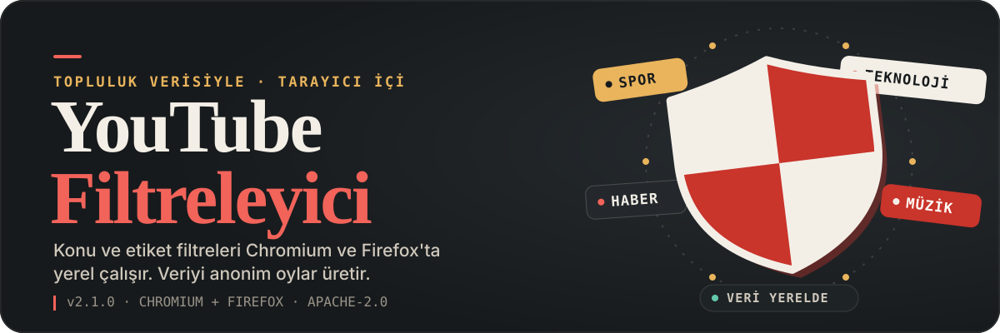
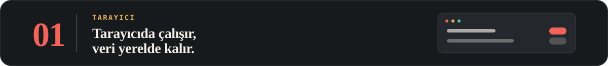
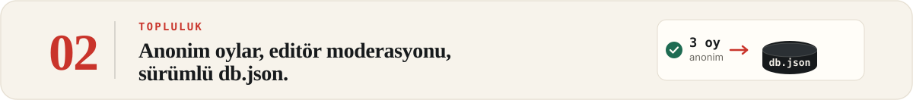
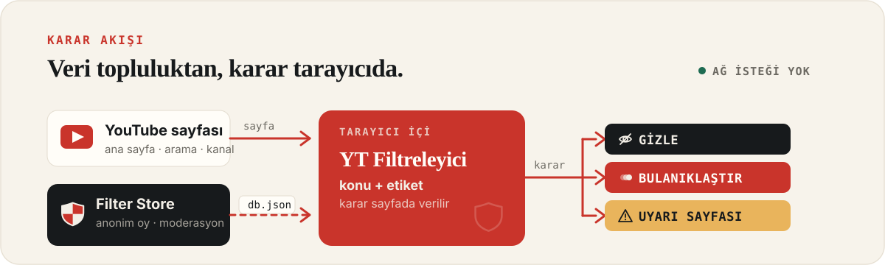
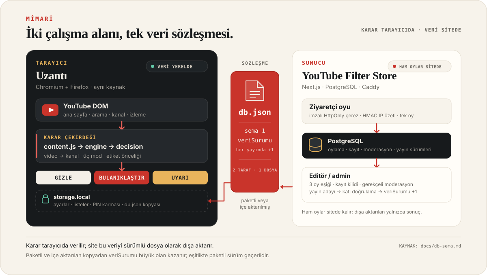
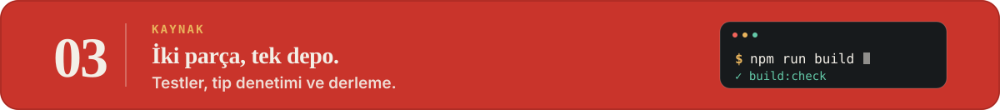

# YouTube Filtreleyici

<p align="center">
  
</p>

**YouTube'un gürültüsünü topluluk verisiyle süz.** Konu ve etiket tabanlı filtreler Chromium ve Firefox'ta yerel çalışır. Veriyi YouTube Filter Store'daki anonim oylar üretir; uzantı filtre kararı için ağdan veri çekmez.

<p align="center">
  
</p>
<p align="center"><sub>YouTube Filter Store — yerel demo verisiyle alınmış ana sayfa görüntüsü.</sub></p>

<p align="center">
  <sub><a href="../../releases">Sürüm notları ve paketler →</a></sub>
</p>

## Ne yapar?

YouTube'un ana sayfa, arama, kanal ve izleme sayfalarında çalışır. Her içerik önce video düzeyinde değerlendirilir; video verisi yoksa ve kanal kontrolü açıksa kanal verisine bakılır. Sonuç kullanıcıya göre **gizle**, **bulanıklaştır** veya **uyarı sayfası** olarak uygulanır.

| Uzantı | Site |
|---|---|
| YouTube sayfalarını tarayıcıda filtreler. Ayarlar, listeler ve PIN karması yerel kalır. | Anonim oyları toplar, editör/admin moderasyonunu yürütür ve sürümlü `db.json` yayımlar. |

## Uzantı

<p align="center">
  
</p>

Chromium ve Firefox için aynı kaynaktan üretilir. Filtre kararı tarayıcıda verilir; YouTube sayfasından ayrılmadan çalışır.

| Filtre | İstisnalar |
|:---:|:---:|
|  |  |
| <sub>Filtre modu ve konular</sub> | <sub>Beyaz, kara ve özel listeler</sub> |

<p align="center">
  
</p>
<p align="center"><sub>Görünüm — arayüz temizleme ve koyu tema</sub></p>

### Öne çıkanlar

- **Üç mod:** Serbest, Orta ve Katı; konu ve etiket kurallarını farklı genişlikte uygular.
- **Esnek engelleme:** Konu ve etiketler için izin ver, gizle, bulanıklaştır veya uyarı sayfası.
- **İstisnalar:** Beyaz liste, kara liste ve özel listeler; video ya da kanalı tek tıkla listeye ekleme.
- **Hızlı karar bandı:** Geçerli sayfanın kararını ve sebebini gösterir; "Her zaman izin ver / engelle" aksiyonları sunar.
- **İsteğe bağlı hızlı ekleme:** Video ve kanal sayfalarında beyaz/kara listeye tek tıkla ekleme rayı.
- **Sadeleştirme:** Shorts, yorumlar, önerilen videolar ve hareketli küçük resim önizlemelerini ayrı ayrı kapatma.
- **İsteğe bağlı PIN kilidi:** PIN varsa ayarlar her açılışta istenir; PIN PBKDF2-SHA256 karması olarak saklanır, yazma işlemleri 10 dakikalık oturumla açılır.
- **Yerel yedekleme:** Liste paketleri, tam ayar yedeği ve isteğe bağlı `db.json` içe/dışa aktarma.

## Site

<p align="center">
  
</p>

YouTube Filter Store, uzantının kullandığı veriyi üreten Next.js uygulamasıdır. Ziyaretçi hesap açmadan oy verir; editörler kayıt ve moderasyon yapar; adminler yayını yönetir.

<p align="center">
  
</p>
<p align="center"><sub>Video oylama sayfası — yerel demo verisi; konu/etiket oyları, 3 oy eşiği ve sonuç paneli.</sub></p>

### Öne çıkanlar

- **Anonim oylama:** İmzalı HttpOnly çerez kimliğiyle hedef + konu/etiket başına tek oy; oy değiştirilebilir, hesap gerekmez.
- **Topluluk eşiği:** Sonuç için en az 3 oy gerekir. Ana konu net puana göre belirlenir; beraberlikte upvote ve taksonomi sırası kullanılır.
- **Rol tabanlı yönetim:** Ziyaretçi, editör ve admin rolleri. Herkese açık kayıt yoktur; hesapları admin oluşturur.
- **Moderasyon:** Oy geri alma, içerik kilitleme, çerez/ağ engeli, gerekçeli moderasyon kaydı ve bakım betiği.
- **Editör ve admin akışı:** Linkten içerik ekleme, YouTube metadata çözümleme, talep kuyruğu, arşivleme ve metadata düzeltme.
- **Yayın:** `db.json` önizlemesi, doğrulama, sürüm artırma, yayımlama ve indirme; geçmiş sürümler `?surum=N` ile sabit.
- **Kamusal deneyim:** Ana sayfa, keşfet, içerik sayfaları, gizlilik, koşullar, iletişim ve Türkçe hata sayfaları.

## Nasıl çalışır?

Uzantı veriyi ağdan çekmez. Konu/etiket kayıtlarını paketlenmiş `db.json` dosyasından veya kullanıcının içe aktardığı bir yedekten okur. Site oyları toplar, moderasyon sonucunu aynı sözleşmeye dönüştürür ve yalnızca yetkili adminin yayımlamasına izin verir.

<p align="center">
  
</p>

| Sıra | Karar kuralı |
|---|---|
| 1 | Video verisi varsa yalnızca video değerlendirilir. |
| 2 | Video verisi yoksa ve kanal kontrolü açıksa kanal verisine bakılır. |
| 3 | Engellenen bir etiket her modda engeller. |

## Mimari

Tek depo iki çalışma alanı barındırır: kararı tarayıcıda veren uzantı ve veriyi üreten Next.js sitesi. İki taraf yalnızca sürümlü `db.json` sözleşmesinde buluşur; ham oylar ve moderasyon kayıtları sitede kalır.

<p align="center">
  
</p>

| Katman | Görev | Sınır |
|---|---|---|
| **Uzantı** | YouTube DOM'unu izler, yerel kopyadan karar üretir ve gizle / bulanıklaştır / uyarı uygular. | Filtre için ağ isteği yapmaz; ayarlar, listeler ve PIN karması `storage.local` içinde kalır. |
| **Site** | Anonim oyları toplar, editör/admin moderasyonunu yürütür ve yayın adayını doğrular. | Ham oylar PostgreSQL'de kalır; dışa aktarılan dosya yalnızca sonuçları taşır. |
| **Köprü** | Sürümlü `db.json` (sema 1) paketlenir veya içe aktarılır. | `veriSurumu` büyük olan kazanır; eşitlikte paketli sürüm kullanılır. |

## Geliştirme

<p align="center">
  
</p>

Uzantı kaynağı `src/`, site kaynağı `site/` altındadır. `chromium/` ve `firefox/` derleme çıktısıdır; doğrudan düzenlenmez.

Gereksinimler: **Node.js 20+** (uzantı), **Node.js 22.18+** (site; `.nvmrc` 22.23.4).

```bash
# Uzantı
npm install
npm run build
npm test
npm run build:check

# Site
cd site
npm install
Copy-Item .env.example .env
npm run dev
npm test
npm run tip
npm run build
```

## Proje yapısı

```text
src/                  Uzantı kaynakları
manifests/            Chromium ve Firefox manifestleri
scripts/              Derleme, ikon ve paketleme betikleri
tests/                Node testleri + tests/smoke/ (jsdom)
chromium/             Derlenmiş Chromium uzantısı
firefox/              Derlenmiş Firefox uzantısı
site/                 Next.js + TypeScript + PostgreSQL site uygulaması
docs/                 Ürün kuralları, şemalar, QA ve gizlilik belgeleri
docs/gorseller/       README ekran görüntüleri
assets/readme/        README hero, bölüm şeritleri ve mimari SVG'leri
```

## Belgeler

| Belge | Kapsam |
|---|---|
| [`docs/SISTEM_TASARIMI.md`](docs/SISTEM_TASARIMI.md) | Ürün kurallarının tek kaynağı |
| [`docs/db-sema.md`](docs/db-sema.md) | `db.json` sözleşmesi ve sürüm kuralları |
| [`docs/SITE_HAZIRLIK.md`](docs/SITE_HAZIRLIK.md) | Site rolleri ve ürün kararları |
| [`site/README.md`](site/README.md) | Site kurulumu, komutları ve mimarisi |
| [`docs/SUNUCU_KURULUM.md`](docs/SUNUCU_KURULUM.md) | Docker Compose ile sunucu kurulumu |
| [`docs/SITE_QA.md`](docs/SITE_QA.md) | Elle QA ve kabul listesi |
| [`docs/GIZLILIK.md`](docs/GIZLILIK.md) | Uzantı gizlilik politikası |
| [`CHANGELOG.md`](CHANGELOG.md) | Değişiklik geçmişi |

## Gizlilik ve güvenlik

Uzantı hiçbir kişisel veri toplamaz, sunucuya göndermez ve satmaz. Ayarlar, listeler, PIN karması, sayfadan toplanan kanal adı/avatarı ve isteğe bağlı `db.json` kopyası yalnızca tarayıcının yerel deposunda tutulur.

Site, anonim oy için imzalı HttpOnly çerez kimliği ve `IP_HASH_SECRET` ile üretilmiş HMAC-SHA256 IP özeti kullanır; ham IP saklamaz. Analitik, reklam ve üçüncü taraf izleme yoktur. Ayrıntılar: [`docs/GIZLILIK.md`](docs/GIZLILIK.md) ve sitenin `/gizlilik` sayfası.

## Sürüm ve lisans

Son sürüm **2.1.0**. Paketler ve sürüm notları: [GitHub Releases](../../releases). Değişiklikler: [`CHANGELOG.md`](CHANGELOG.md).

[Apache License 2.0](LICENSE). Bu proje YouTube'un resmî bir ürünü değildir.

## Notlar

- Paketli `src/data/db.json` şu an örnek düzeyinde; yaygın YouTube içerikleri "bilinmeyen" olarak değerlendirilir. Kapsam, site yayını ve topluluk oylarıyla büyür.
- Gerçek YouTube üzerinde uçtan uca tarayıcı/ekran okuyucu QA'sı ve Docker/PostgreSQL/Caddy üretim denemesi bu makinede yapılmadı.
- Site içi "Bildir" formu yoktur; iletişim [GitHub Issues](../../issues) üzerindendir.
